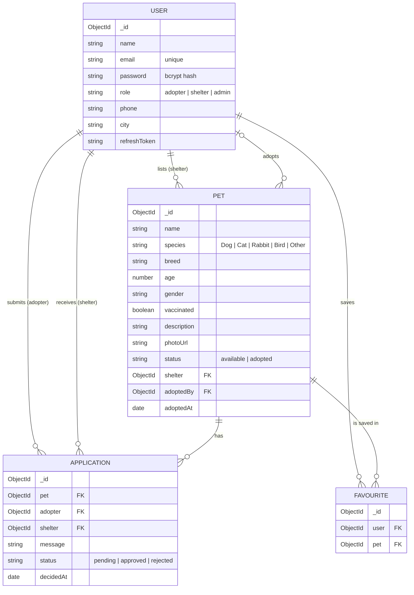

# PawHome – Pet Adoption Portal

PawHome is a MERN stack web app where **shelters** list pets for adoption, **adopters** browse, favourite and apply to adopt them, and an **admin** manages the whole portal.

**Live demo:** Frontend: `<add Vercel link>` · Backend API: `<add Render link>`

## Features

- Register and login with **bcrypt** password hashing and **JWT access + refresh tokens**
- 3 roles with **role-based access (RBAC)**: adopter, shelter and admin
- **Pet listings**: shelters add, edit and delete pets (breed, age, gender, vaccination status, photo URL)
- **Search and filter** by name, species, breed, age range, gender and vaccination, with sorting and **pagination**
- **Adoption applications** with a status flow: `pending → approved / rejected`
  - one application per adopter per pet (unique index)
  - approving one application marks the pet as adopted and rejects the other pending applications for that pet
  - adopters can withdraw a pending application
- **Favourites** list for every adopter (unique compound index, so no duplicates)
- **Shelter dashboard** using the aggregation pipeline: adoptions per month, pets by species and applications by status
- **Admin dashboard**: users by role, pets by species, adoptions per month, top shelters, and user management
- Charts drawn with plain CSS (no chart library)
- Centralised error-handling middleware with proper HTTP status codes (400, 401, 403, 404, 409, 500)
- React frontend with routing, controlled forms, Context API, protected pages and automatic token refresh

## Tech Stack

| Part | Used |
|------|------|
| Backend | Node.js, Express, Mongoose, bcrypt, jsonwebtoken, dotenv, cors |
| Database | MongoDB (Atlas for deployment) |
| Frontend | React (Vite), react-router-dom, Fetch API, Context API |
| Deployment | Render (backend), Vercel (frontend) |

## Folder Structure

```
PawHome/
├── backend/
│   ├── config/db.js
│   ├── controllers/     auth, pet, application, favourite, report, user
│   ├── middleware/      auth.middleware.js (protect + roles), error.middleware.js
│   ├── models/          User, Pet, Application, Favourite
│   ├── routes/
│   ├── seed.js          sample data
│   └── server.js
├── frontend/
│   └── src/
│       ├── components/  Navbar, PrivateRoute, PetCard, BarChart
│       ├── context/     AuthContext.jsx
│       ├── pages/       adopter/, shelter/, admin/ + public pages
│       └── utils/       api.js (fetch + token refresh), helpers.js
└── postman/PawHome.postman_collection.json
```

## Setup (run locally)

You need Node.js 18+ and MongoDB, either local or Atlas.

**1. Backend**

```bash
cd backend
npm install
cp .env.example .env      # then edit the values
npm run seed              # optional: adds demo users, pets and applications
npm run dev               # runs on http://localhost:4000
```

**2. Frontend** (in a second terminal)

```bash
cd frontend
npm install
cp .env.example .env
npm run dev               # opens on http://localhost:5173
```

## Environment Variables

**backend/.env**

| Variable | Example | Meaning |
|----------|---------|---------|
| PORT | 4000 | Port for the API |
| MONGO_URI | mongodb://127.0.0.1:27017/pawhome | MongoDB connection string |
| ACCESS_TOKEN_SECRET | any long random text | Secret for signing access tokens |
| REFRESH_TOKEN_SECRET | another long random text | Secret for signing refresh tokens |
| ACCESS_TOKEN_EXPIRES | 15m | Access token lifetime |
| REFRESH_TOKEN_EXPIRES | 7d | Refresh token lifetime |
| CLIENT_URL | http://localhost:5173 | Frontend URL allowed by CORS |

**frontend/.env**

| Variable | Example |
|----------|---------|
| VITE_API_URL | http://localhost:4000 |

The `.env` files are in `.gitignore` and are never committed.

## Demo Accounts

After `npm run seed`, every account uses the password **password123**.

| Role | Email |
|------|-------|
| Admin | admin@pawhome.com |
| Shelter | happytails@pawhome.com, secondchance@pawhome.com |
| Adopter | karan@pawhome.com, isha@pawhome.com, arjun@pawhome.com, pooja@pawhome.com |

## Database Design (ER Diagram)



**Indexes**

- `User.email`: unique
- `Pet { species, status }`: speeds up the browse/filter page
- `Pet { shelter }`: speeds up the shelter dashboard
- `Application { pet, adopter }`: unique, so an adopter can apply only once per pet
- `Favourite { user, pet }`: unique, so the same pet can't be saved twice

**Aggregation pipelines** (`controllers/report.controller.js`)

- Adoptions per month: `$match` adopted, then `$group` by `$year` and `$month` of `adoptedAt`, then `$sort`
- Pets by species: `$group` by species with `$sum` and `$cond` to count available/adopted
- Applications by status, users by role and top shelters: `$group`, `$sort`, `$limit`

## API Documentation

Base URL: `http://localhost:4000` locally, or the Render URL in production.
Protected routes need the header `Authorization: Bearer <accessToken>`.

### Auth

| Method | Endpoint | Access | Description |
|--------|----------|--------|-------------|
| POST | /api/auth/register | Public | Register as adopter or shelter |
| POST | /api/auth/login | Public | Login, returns accessToken, refreshToken and user |
| POST | /api/auth/refresh | Public | Send `{ refreshToken }` to get a new accessToken |
| POST | /api/auth/logout | Public | Send `{ refreshToken }` to cancel it |
| GET | /api/auth/profile | Logged in | Current user details |

### Pets

| Method | Endpoint | Access | Description |
|--------|----------|--------|-------------|
| GET | /api/pets | Public | Available pets. Query: `search, species, breed, minAge, maxAge, gender, vaccinated, sort (age_asc / age_desc), page, limit` |
| GET | /api/pets/:id | Public | Pet details with shelter info |
| GET | /api/shelter/pets | Shelter | All pets of the logged-in shelter |
| POST | /api/pets | Shelter | Add a pet |
| PUT | /api/pets/:id | Owner shelter / Admin | Update a pet |
| DELETE | /api/pets/:id | Owner shelter / Admin | Delete a pet (not allowed once adopted) |

### Applications

| Method | Endpoint | Access | Description |
|--------|----------|--------|-------------|
| POST | /api/applications | Adopter | Apply: `{ petId, message }` |
| GET | /api/applications/my | Adopter | My applications |
| DELETE | /api/applications/:id | Adopter | Withdraw a pending application |
| GET | /api/applications/shelter | Shelter | Applications for my pets (`?status=pending`) |
| PATCH | /api/applications/:id/status | Shelter | `{ status: "approved" or "rejected" }` |

### Favourites

| Method | Endpoint | Access | Description |
|--------|----------|--------|-------------|
| GET | /api/favourites | Adopter | My favourite pets |
| POST | /api/favourites | Adopter | Add: `{ petId }` |
| DELETE | /api/favourites/:petId | Adopter | Remove |

### Reports and Users

| Method | Endpoint | Access | Description |
|--------|----------|--------|-------------|
| GET | /api/reports/shelter | Shelter | Adoptions per month, pets by species, applications by status |
| GET | /api/reports/admin | Admin | Users by role, pets by species, adoptions per month, top shelters |
| GET | /api/users | Admin | All users (`?role=shelter`) |
| DELETE | /api/users/:id | Admin | Delete a user |

### Error format

Every error comes back in the same shape:

```json
{ "success": false, "message": "This pet is already adopted" }
```

## Postman

Import `postman/PawHome.postman_collection.json` into Postman. Run the three **Login** requests first; they save the tokens into collection variables automatically. To test the live API, change the `baseUrl` variable to the Render URL.
